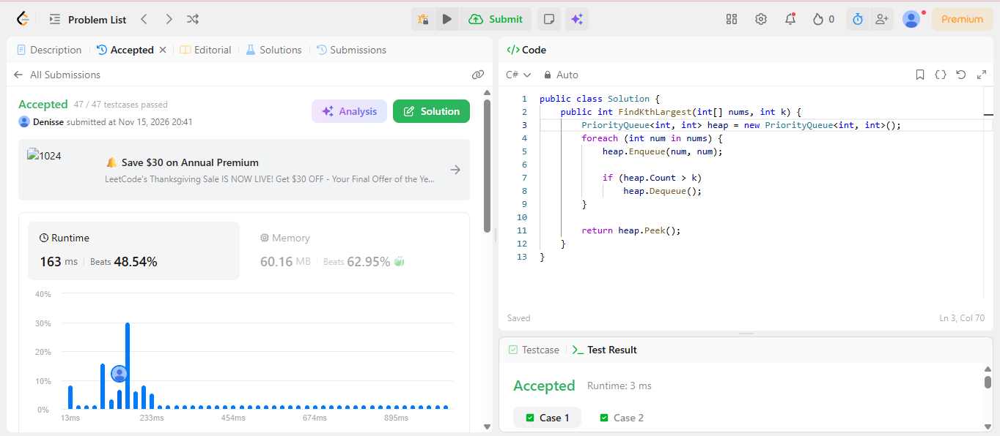
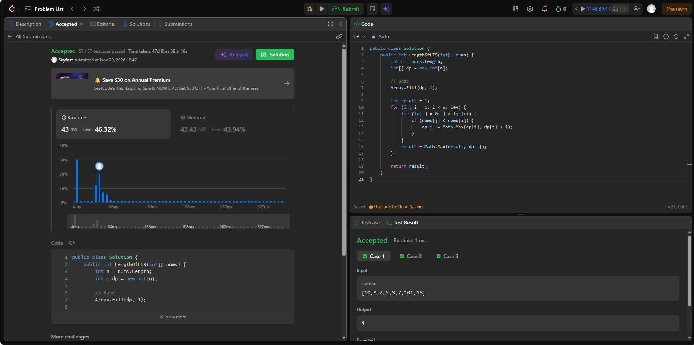
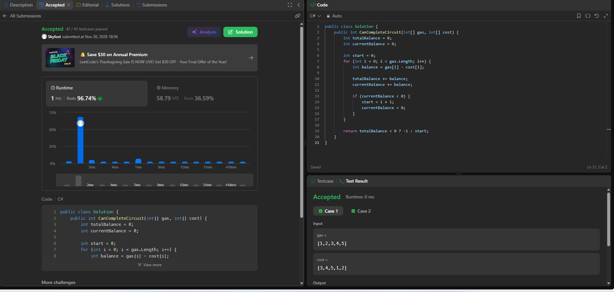
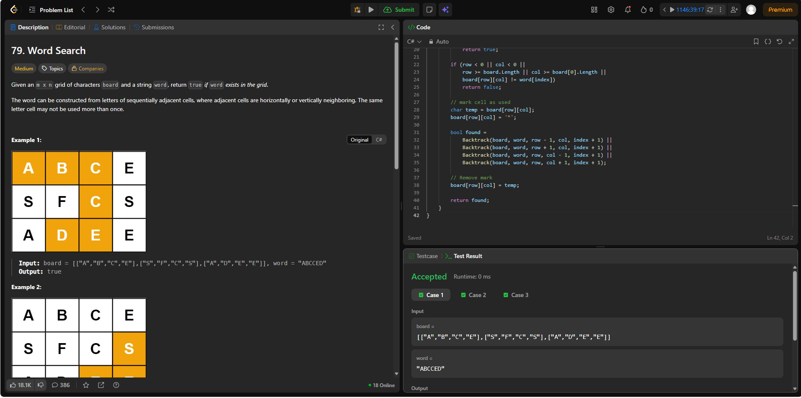

[Kth Largest Element in an Array](https://leetcode.com/problems/kth-largest-element-in-an-array/description/)

Autor: Denisse Gallardo (denissegallardo09)  
Familia: Heap
Idea: Utilizamos un Min-Heap de tamaño máximo k para mantener los k elementos más grandes encontrados hasta el momento. Cuando el heap alcanza ese tamaño, si encontramos un número mayor que su raíz, eliminamos el menor y agregamos el nuevo valor.
Complejidad:
  n= Cantidad de elementos del arreglo
  k= Posición del elemento mayor que queremos encontrar
  Tiempo: O(n log k)
  Espacio: O(k)

[Largest Number](https://leetcode.com/problems/largest-number/description/)

Autor: Denisse Gallardo (denissegallardo09)  
Familia: Sorting (Ordenamiento)
Idea: Convertimos todos los números a cadenas y los ordenamos utilizando un comparador basado en la concatenación: para dos valores a y b, colocamos primero a si a + b es mayor que b + a (concatenados, no sumados).
Complejidad:
  n= cantidad de elementos del arreglo
  Tiempo: O(n log n)
  Espacio: O(n)

[Longest Increasing Subsequence](https://leetcode.com/problems/longest-increasing-subsequence/description/)

Autor: Alejandro Atehortua (Skyfost12)  
Familia: Dynamic Programming
Idea: Creamos un arreglo dp donde cada posición representa la longitud de la subsecuencia creciente más larga que termina exactamente en ese índice. Para cada elemento, revisamos los elementos anteriores. Si encontramos uno menor, podemos extender la subsecuencia que termina en él.
Complejidad:
  n= cantidad de elementos del arreglo
  Tiempo: O(n²)
  Espacio: O(n)

[Gas station](https://leetcode.com/problems/gas-station/description/)

Autor: Alejandro Atehortua (Skyfost12)  
Familia: Greedy
Idea: Recorrimos las estaciones una sola vez acumulando la diferencia entre el gas disponible y el costo del viaje. Si el tanque acumulado queda negativo, se descarta todo el tramo recorrido como posible punto de partida y se reinicia el acumulado desde la siguiente estación. Si el balance total es negativo no existe solución, sino, el valor de start es la respuesta.
Complejidad:
  n= cantidad de elementos del arreglo
  Tiempo: O(n)
  Espacio: O(1)

[Word search](https://leetcode.com/problems/word-search/description/)

Autor: Alejandro Atehortua (Skyfost12)  
Familia: Backtracking
Idea: Recorremos la grilla buscando una celda que coincida con la primera letra de la palabra e iniciamos una búsqueda DFS. Comprobamos si la letra de la celda coincide con la posición actual de la palabra; si coincide marcamos la celda como utilizada y buscamos la siguiente letra en sus cuatro direcciones posibles, si ninguna dirección permite completar la palabra deshacemos la marca y probamos otra alternativa.
Complejidad:
  m= Cantidad de filas
  n= Cantidad de columnas
  L= Longitud de la palabra
  Tiempo: O(m n · 4^L)
  Espacio: O(L)

