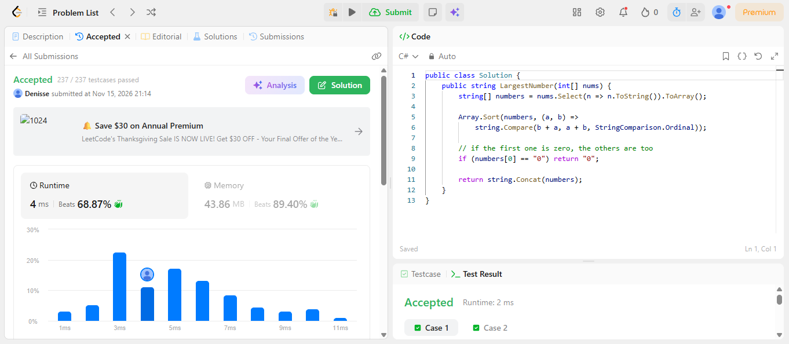

[Kth Largest Element in an Array](https://leetcode.com/problems/kth-largest-element-in-an-array/description/)

Autor: Denisse Gallardo (denissegallardo09)  
Familia: Heap
Idea: Utilizamos un Min-Heap de tamaño máximo k para mantener los k elementos más grandes encontrados hasta el momento. Cuando el heap alcanza ese tamaño, si encontramos un número mayor que su raíz, eliminamos el menor y agregamos el nuevo valor.
Complejidad:
  n= Cantidad de elementos del arreglo
  k= Posición del elemento mayor que queremos encontrar
  Tiempo: O(n log k)
  Espacio: O(k)

[Largest Number](https://leetcode.com/problems/largest-number/description/)

Autor: Denisse Gallardo (denissegallardo09)  
Familia: Sorting (Ordenamiento)
Idea: Convertimos todos los números a cadenas y los ordenamos utilizando un comparador basado en la concatenación: para dos valores a y b, colocamos primero a si a + b es mayor que b + a (concatenados, no sumados).
Complejidad:
  n= cantidad de elementos del arreglo
  Tiempo: O(n log n)
  Espacio: O(n)

